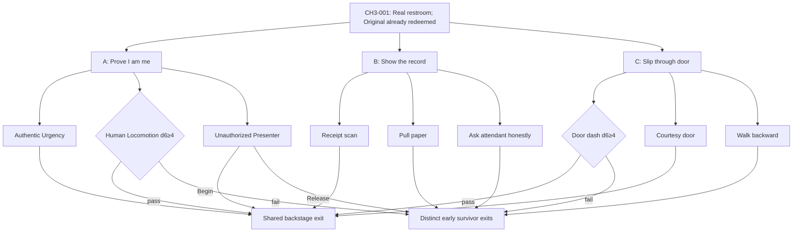

# The Acceptable Error — Chapter 3 Reboot Route and Presentation Audit
**Date:** 2026-11-18  
**Status:** Creative structure reviewed; playable Chapter 3 JSON **not yet rewritten**. Findings are a handoff for final prose/route authoring, not permission to publish or generate art.  
**Canonical creative source:** `docs/109_CH3_REBOOT_ONE_EXPERIENCE_PER_PERSON_20261118.md` on draft PR #5 (`story/ch3-reboot-20261118`); it supersedes the old Chapter 3 narrative.  
**Source of Chapter 2 endings:** public `story/chapters/chapter-02.draft.json` (blob SHA `e51c11df9a89a0fdb4ec6d63790f81ec0b6f6173`).  
**Archived old Chapter 3:** `story/archives/chapter-03-pre-reboot-20261118.json` remains byte-preserved; storyboard manifest marks the old graph `archived`.

## 1. Chapter 2 → Chapter 3 entry contract

The **five living Chapter 2 ending nodes** already set `chapter3_entry_group` and carry `storyboardNextChapter: "chapter-03"`. These are storyboard-only handoffs while Chapter 3 is archived; do **not** convert them to active runtime links prematurely.

| Chapter 2 living node | Entry group | Additional source-state |
| --- | --- | --- |
| `end_concourse_robot` | `public_concourse` | `ch2_exit_route=tram_robot_crash` |
| `end_public` | `public_concourse` | Existing `ch2_exit_route` varies |
| `end_customs` | `public_concourse` | Existing `ch2_exit_route` varies |
| `end_maintenance` | `service_infrastructure` | Existing `ch2_exit_route` varies |
| `end_underground_station` | `underground_transit` | `ch2_exit_route=tram_silent_station`, `tram_satisfaction_certified=true` |

Five **fatal** Chapter 2 endings (`fatal_sorter`, `fatal_hopper`, `fatal_transformation`, `fatal_planting`, `fatal_roots`) **must not** enter Chapter 3.

**Missing connective prose:** Three compact arrival variants are needed for public concourse, service infrastructure and underground transit before they converge at the **same real restroom with the same attendant and one-use identity mismatch**. Do not invent a fourth mandatory entry or reveal the Original. Optional one-line reactions may reflect a tram damage claim, equipment-registration status or lingering botanical contamination without adding a new administrative incident.

## 2. Approved Chapter 3 route topology

The diagram's EARLY node summarizes **six distinct early living endings**, **not** a single joined node in the authored graph. BACK is one actual shared conclusion, **CH3-EXIT — An Ordinary Door**.

### Terminal outcomes (12 reachable result paths; 7 distinct terminal ending nodes)

| From player choice/result | Terminal route | Survival |
| --- | --- | --- |
| A → Authentic Urgency → CH3-006A | Shared CH3-EXIT | Alive |
| A → Human Locomotion pass (CH3-006B) | Shared CH3-EXIT | Alive |
| A → Human Locomotion fail | Padded cart outside | Alive |
| A → Unauthorized Presenter → Begin (CH3-005A) | Shared CH3-EXIT | Alive |
| A → Unauthorized Presenter → Release (CH3-005C) | Early service exit with presenter | Alive |
| B → Scan receipt (CH3-REC-A) | Shared CH3-EXIT | Alive |
| B → Pull paper (CH3-REC-B) | Paper emergency exterior exit | Alive |
| B → Ask sincerely (CH3-REC-C) | Attendant's early service exit | Alive |
| C → Dash pass (CH3-DOOR-A) | Shared CH3-EXIT | Alive |
| C → Dash fail | Attendant's early public escort | Alive |
| C → Hold door (CH3-DOOR-B) | Shared CH3-EXIT | Alive |
| C → Walk backward (CH3-DOOR-C) | Zero-second visit / exterior exit | Alive |

**Counts:** 6 outcomes converge backstage, 6 finish early; 7 unique living ending nodes total. **No fatal Chapter 3 endings are approved or required.** There should therefore be **no Chapter 3 deathPopup or death art call** in the new graph unless the owner later approves an actual fatal choice. This is intentional, not missing death-popup production.

## 3. Checks, inventory, and inherited state

1. **CH3-006B Human Locomotion:** hidden d6, **need 4**, **+1 only while `timing_clicker` is actually held**. Its established prior-chapter six-second rhythm times the leap. Nonconsuming; pass backstage / fail safely outside. Base 50%; with the held clicker, 4 of 6 faces pass (66⅔%). Standard visible risk marker, no visible roll by default. **Important source fact:** Chapter 2 can permanently **take** `timing_clicker` via `sabotage_clicker_stalled`. Do not grant the modifier merely because the item was once owned.
2. **CH3-DOOR-A Dash:** hidden d6, **need 4**, **no modifier**, pass into a restroom **exit vestibule** and then backstage / fail early public escort. Standard risk marker. A distinct pass/fail destination; no reroll or injury.
3. **No new inventory in approved CH3:** Receipt is a scene prop; document-escort designation is a temporary situation; `FASTEST SATISFIED VISITOR` ribbon is visual, not an item. **No carried item should be removed**, and all other earlier-chapter flags/items persist unchanged.
4. Preserve the inherited `spore_infected`, `thorn_infected` and related Chapter 2 contamination/cure state. A surviving Chapter 2 route may leave while contaminated; the Chapter 3 intro should not silently claim a cure or reset the condition.
5. Preserve possible prior House equipment registration, held photo, staff/examiner/director credentials, other retained items, and `ch2_exit_route`. A callback must be authored only when reachable and genuinely useful. **Already selected callbacks:** clicker modifier and the protagonist spotting a professionally mistimed applause cue in CH3-DOOR-B. Additional callbacks are optional, not a checklist.
6. Validate the item condition and check modifier syntax against the current importer/engine before integrating, then test both pass/fail outcomes and with/without clicker. The existing source demonstrates `check.mods` but the Chapter 3 check itself has not been authored.

## 4. Presentation-mode and dialogue audit

Per `docs/107_PRESENTATION_MODE_AUDIT_20261117.md` and explicit owner reminder: avoid old Chapter 3's 62-node pattern of machine/character transcripts inside Narrative B.

- **Narrative B:** second-person present-tense descriptions, events and environments. Typed at dialogue speed; long prose paginates with presentation `CONTINUE`; selected consequences append. CH3-EXIT is a single Narrative B conclusion, no new decision.
- **Dialogue:** attendant and presenter must use actual `mode: dialogue`, NPC portrait/view and distinct `{say}` / `{desc}` runs. The visiting door-holder can be an incidental second `who` speaker within the attendant scene; do not require a whole new repeated question bank.
- **Player-paced single-choice beats:** first actual request to use the restroom (still needing final intro wording), CH3-002B **"THAT DOESN'T TELL ME WHO USED IT."**, CH3-REC-A **"BUT THAT PIECE OF PAPER IS?"**, CH3-REC-C **"EVEN THOUGH YOU KNOW THE RECORD IS WRONG?"**, and CH3-006A **"I NEED TO USE IT, TOO!"** are natural one-card dialogue advances. Wording still subject to line polish where not expressly locked. These are **not** new branching menus; the player line must echo into the transcript before the reply.
- **Card semantics:** `kind:spoken` with renderer-added quotes for spoken lines; `kind:action` for red action ink. Never put literal quotes in card text. Mixed action/speech echo typed correctly. Avoid authoring player lines passively in narrator prose.
- **Focus A:** can be useful for the record slip or restroom reader if a focused object interaction is visually justified; it is **not** permission to create an extra menu or a compulsory detective investigation.
- **Character rule:** never show the protagonist's face. Portray the attendant/presenter as humans, not merely another machine voice. Keep humor warm, physical and short.

## 5. Artwork/archive hazard

The old Chapter 3's **archived** artwork and items still exist in shared catalogues: **21 ungenerated Pavilion scene briefs**, **7 Pavilion Focus briefs**, **3 Pavilion death-screen briefs**, **1 ungenerated Registrar portrait**, and **16 `pavilion_*` item definitions**. Their presence **must not** be interpreted as approval to generate or import them for the reboot. The story manifest status alone is not a sufficient visual cue to every future art worker.

**Required before any new Chapter 3 art generation:**

- Mark legacy records clearly as retired/archived/unused using schema-compatible metadata and preserve their provenance; never delete historical files or give unsupported status enum values.
- Build **new** scene, portrait, focus and item art calls from the final approved rewritten graph, with current Chapter 3 IDs and proper ownership.
- New likely needs: real Pavilion restroom exterior/attendant conversation, live human-verification stage and presenter, long-record printer/reader, door/exit vestibule, backstage corridor, and specific consequence-state variants. These are **planning candidates**, not approved new production briefs.
- Do not reopen or change Chapters 1–2 selected art.

## 6. Gaps before playable JSON

| Priority | Gap | Resolution |
| --- | --- | --- |
| **Blocking creative** | Exact three arrival variants and transition to one real restroom | Story Director proposes; owner reviews/approves |
| **Blocking creative** | Opening CH3-001 still labeled `UNAPPROVED SAMPLE PROSE` in doc 109 | Polish the attendant's initial exchange in dialogue mode; explicitly player-select the first spoken request, then present approved A/B/C |
| **Authoring polish** | Detailed presenter/attendant lines and internal transitions are concept-approved but not all final | Tight second-person narration, small NPC exchanges, single-choice beats; do not change locked outcomes |
| **Implementation** | Old Chapter 3 still archived; no new playable story file/manifest switch | Create new `story/chapters/chapter-03.draft.json` once final prose is approved; retain archive; validate 12 paths, 7 terminals, checks & conditions |
| **Implementation** | Chapter 2 links are storyboard-only `end:true` | Gameplay PMO to plan actual runtime handoff after chapter authoring, independent of story approval |
| **Production** | Old art briefs still listed as not-started | Quarantine old calls, register new art only after narrative and visual briefs are approved |

## Next recommended creative batch

1. Draft **three** brief Chapter 2 arrival paragraphs (public, service, underground) that all converge naturally at the **real restroom**.
2. Refine the opening into **Narrative B → Attendant dialogue → player-spoken single-choice request → attendant's refusal and record contradiction → approved A/B/C**.
3. Have the owner approve that final opening wording. Then author new JSON in an isolated draft and run validator/route QA before any art commissioning or game integration.

**No main-branch merge or live-game integration is authorized by this audit.**
