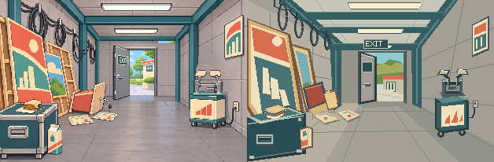
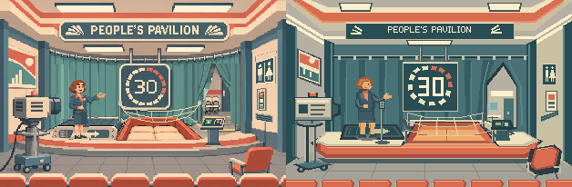

# Chapter 3 pixel art pilot review

Backstage and Locomotion Stage are **generated and unselected**. These are the existing v01 pilot candidates; publication changes no selection, approval, narrative or gameplay. The full HTML gallery, prompts, detailed references, native drawing sources, manifests and QA remain preserved at the [original pilot commit](https://github.com/InterstellarHarvest/CYOA-storyboard/commit/b05653e1c5ce4c995588975eaf3bd41eb8f128ab).

[HTML gallery source and download](../index.html) · [Portable HTML gallery](../standalone-gallery.html) · [Candidate hashes and source manifest](../manifest.json) · [QA results](../qa/results.json) · [Standing publication instruction](PUBLICATION_POLICY.txt)

The images below place **approved artwork on the left and the unselected candidate on the right**. GitHub may scale images to the browser width; open the PNG directly to inspect its original dimensions. Native comparison canvases are 628×206, comprising two 314×206 scenes. Exact 4× canvases are 2512×824, comprising two 1256×824 scenes.

## Backstage

[Open native comparison PNG](comparisons/backstage-approved-left-candidate-right-native.png) · [Open exact 4× comparison PNG](comparisons/backstage-approved-left-candidate-right-4x.png) · [Candidate native PNG](../candidates/CH3-PILOT-backstage-v01.png) · [Candidate exact 4× PNG](../previews/CH3-PILOT-backstage-v01-4x.png)

The candidate uses 45 RGB colors versus 25,215 in the approved scene. It replaces stippled concrete with broad planes and reconstructs the cables, scenery, props, exit and attached clapper. Evaluate the flatter material treatment, prop silhouettes, clapper paddles and EXIT sign placement above the doorway.

## Locomotion Stage

[Open native comparison PNG](comparisons/locomotion-approved-left-candidate-right-native.png) · [Open exact 4× comparison PNG](comparisons/locomotion-approved-left-candidate-right-4x.png) · [Candidate native PNG](../candidates/CH3-PILOT-locomotion-v01.png) · [Candidate exact 4× PNG](../previews/CH3-PILOT-locomotion-v01-4x.png)

The candidate uses 36 RGB colors versus 16,885 in the approved scene. It reconstructs the moving belt, padded pit, sparse net, stationary landing and simplified presenter. Evaluate net attachment and height, landing width, console overlap, depth and character stiffness. The sign wording and numeric display remain PEOPLE'S PAVILION and 30.

## Approved references and native construction

[Reception scene](../references/reception.png) · [Reception portrait background](../references/reception-background.png) · [Reception portrait foreground](../references/reception-foreground.png) · [Tour Tram](../references/tour_tram.png) · [Control Tower](../references/control_tower.png) · [Full reference inventory](../manifest.json)

[Backstage detailed conceptual reference](../concept-references/backstage-large-reference.png) · [Locomotion detailed conceptual reference](../concept-references/locomotion-large-reference.png) · [Exact imagegen reference prompts](../generation-prompts.json) · [Generation receipts](../generation-receipts.json) · [Editable native renderer](../reconstruct.py)

Candidates were constructed directly on a 314×206 canvas with explicit integer-coordinate drawing. Their reproducible source supports that construction method; it does not establish hand-painted authorship or artistic success. The larger generated concepts retain their unresolved native-grid authorship limitation and were not downsampled into candidate pixels.

## Verification

The pilot passed 110 image, source and preservation checks; canonical, sync, smoke and Chapter 3 checks; 22 gallery browser checks in Chromium and Firefox; and 60 selected-artwork browser regression checks. All 493 files from the original canonical base remained unchanged. [Actual logs and results](../qa/results.json) · [Comparison dimensions and hashes](manifest.json)

The publication supplement preserves every file from the completed pilot commit. Remote accessibility is verified after push. No live Pages deployment or gameplay runtime check is claimed. Paper Emergency is excluded.
