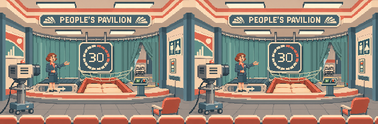
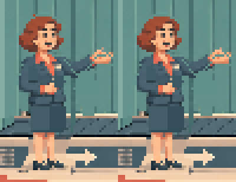

# Chapter 3 targeted repair assessment and presenter test v02

**Maximize useful detail while removing only pixel noise that harms readability at exact 4×.** The v01 reconstructions are not selected and full-scene reconstruction is withdrawn. The currently approved originals remain approved and unchanged.

[HTML assessment and gallery](index.html) · [Portable HTML gallery](standalone-gallery.html) · [Detailed assessment](assessment/targeted-assessment.json) · [Manifest and original source provenance](manifest.json) · [Actual QA results](qa/results.json)

## Assessment before editing

**Locomotion:** preserve the foreground audience chairs, rolling camera, curtains/mounts, architecture, signs, 30 display, fixtures, lighting and doorway exactly. The pit/net/floor/landing remain readable at 4×, and no perspective correction is demonstrated. The first test addresses only six presenter pixels: one detached copper pixel, two hair-edge interruptions, one cheek fringe and two hand-edge transitions.

**Backstage:** no repair is justified in this pass. The cables, scenery, concrete variation, ordinary daylight exit, sandwich/carton/papers/podium and attached clapper retain useful information. Proposed repair mask is closed: **0 pixels**. No Backstage candidate was made.

[Locomotion protected details at 4×](assessment/locomotion-protected-detail-guide-4x.png) · [Locomotion perspective guide](assessment/locomotion-perspective-guide-4x.png) · [Backstage protected details at 4×](assessment/backstage-protected-detail-guide-4x.png) · [Backstage perspective guide](assessment/backstage-perspective-guide-4x.png)

## Six pixel presenter test

**Generated / unselected.** Approved left, candidate right. The full scene contains 64,684 pixels: **6 changed, 64,678 unchanged, 0 changed outside the predeclared mask**.

[Full native comparison PNG](comparisons/locomotion-approved-left-candidate-right-native.png) · [Full exact 4× comparison PNG](comparisons/locomotion-approved-left-candidate-right-4x.png) · [Candidate native PNG](candidate/CH3-LOCOMOTION-presenter-local-v02.png) · [Candidate exact 4× PNG](previews/locomotion-presenter-candidate-v02-4x.png)

[Hair/face before and after at exact 4×](comparisons/hair-face-before-after-4x.png) · [Open hand before and after at exact 4×](comparisons/open-hand-before-after-4x.png) · [Six-pixel binary mask](masks/locomotion-authorized-test-mask.png) · [Mask locator at exact 4×](masks/locomotion-mask-overlay-4x.png) · [Every changed pixel CSV](sources/changed-pixels.csv)

The eyes, eyebrows, nose, smile, costume, near hand, gesture, legs, shoes and all room geometry remain pixel-identical. Some hair/hand contour joins are subjective choices. The small difference is intentional; this is not a completed presenter polish.

## Dimensions and provenance

314×206 opaque RGB; exact 4× export 1256×824. Original color count 16,885; candidate 16,879. No arbitrary palette target, global sharpening, posterization, reduction or downsampling. The original source-derived native-grid authorship limitation remains unresolved. Six logged native pixel edits do not establish full-scene authorship.

- Approved original SHA-256: `be99d790754951bcbcd1c26b94a94ff4e84280f5385735951b0f024b322e13c5`
- Candidate SHA-256: `8d4b6cef5b7d37f9f612da308fdc7868b7f31a9a4eb8947ed3993af66c7cf2e4`

[Approved Backstage native](originals/approved-backstage.png) · [Approved Backstage exact 4×](previews/backstage-approved-4x.png) · [Unchanged approved presenter portrait](references/presenter-idle.png) · [Editable repair script](repair.py) · [Predeclared plan](sources/repair-plan.json) · [Assessment-before-edit record](sources/assessment-first.json)

All 644 preexisting tracked files, including approvals and v01 pilot files, are protected by exact checksums. This review adds only its new version directory. [Preservation checks](qa/pixel-and-preservation.json) · [QA status and limits](qa/results.json)

Stop for Nate’s review before expanding repairs. No canonical registration, integration, merge or public Pages deployment is authorized.
