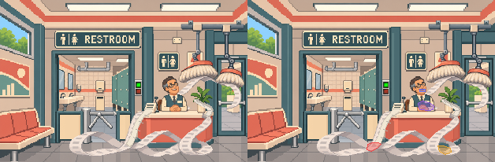
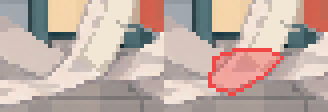

# Paper Emergency targeted quality assessment

**Maximum useful detail, minimum unnecessary pixel noise.** This review uses the currently approved original. Backstage, Locomotion and the unselected six-pixel Locomotion test remain unchanged.

[HTML assessment gallery](index.html) · [Portable HTML gallery](standalone-gallery.html) · [Full findings and repair estimates](assessment/targeted-assessment.json) · [Masks and provenance](manifest.json) · [Actual QA results](qa/results.json)

**No repair candidate is produced. All 64,684 artwork pixels remain unchanged.** Proposed masks are inactive discussion envelopes, not approved repair regions. The colored images below are diagnostic overlays, not candidate artwork.

[Native comparison PNG](comparisons/original-left-assessment-right-native.png) · [Exact 4× comparison PNG](comparisons/original-left-assessment-right-4x.png) · [Approved original native PNG](originals/approved-paper-emergency.png) · [Approved original exact 4× PNG](previews/paper-emergency-approved-4x.png)

## Findings

- **Paper:** the left cream feed unit visibly emits paper. P1 has a branching-looking pale crossing where the continuation and front/back order become unclear. P2 may instead be an intentional continuous fold; trace the strip(s) before separating anything. Flow traces do not prove direction or the number of ribbons.
- **Brushes:** both heads have connected shafts, elbows and ceiling supports. No detached part or impossible joint is demonstrated. Their height and weak floor-contact/sweep cue are staging ambiguities in a still frame, not proven mechanical errors. Preserve useful bristle shading.
- **Attendant:** identity, costume and proportions match the approved character, but the smile and clasped resting hands conflict with the alarmed evacuation narrative. Coordinate any later manual expression/hand-pose edit; a cosmetic mouth flip alone is insufficient.
- **Environment:** protect architecture, signage, the cream paper-feed unit, right-hand plant, gooseneck microphone, counter, equipment and lighting. No change is justified solely by softness or color count.
- **Perspective:** no specific architecture, equipment-placement or mechanical-perspective failure is established. Preserve geometry and global floor shading. Airborne curved receipts need not follow floor vanishing lines.

[Protected details at exact 4×](assessment/protected-details-4x.png) · [Paper continuity traces](assessment/paper-continuity-traces-4x.png) · [Architecture/perspective guides](assessment/architecture-perspective-guide-4x.png) · [Brush attachment guides](assessment/brush-attachment-guide-4x.png)

## Localized proposals for manual pixel work

| Mask | Finding | Provisional changed-pixel estimate |
|---|---|---|
| [P1 — Left floor crossing](masks/P1-proposed-mask.png) | The source-fed strip merges with a returning floor loop in a pale, branching-looking junction. An under/over edge is not consistently readable at 4x. The problem is specific occlusion ambiguity, not overall softness. | 8–24 |
| [P2 — Right floor fold or overlap](masks/P2-proposed-mask.png) | The front descending strip, small right loop and floor shadow merge near the counter base. It is unclear whether this is a crossing of sections or the folded return of the same strip. | 6–16 |
| [A1 — Attendant mouth expression](masks/A1-proposed-mask.png) | The attendant is visibly smiling. The narrative has him shout an emergency instruction. This is a genuine narrative-expression mismatch rather than pixel noise. | 6–14 |
| [A2 — Attendant hands and near forearm](masks/A2-proposed-mask.png) | Clasped hands resting on the counter reinforce a calm seated pose, conflicting with the alarmed beat. Identity, uniform and scale are otherwise continuous. | 20–50 |

Masks are conservative maximum envelopes and are disjoint from protected hardware/identity regions. They are not instructions to repaint every enclosed pixel. No brush-support mask or geometry correction is proposed. Freeze a tighter exact-pixel plan only after the over/under order and intended gesture are selected.

[Right fold at exact 4×](comparisons/P2-original-left-markup-right-4x.png) · [Attendant at exact 4×](comparisons/attendant-original-left-markup-right-4x.png) · [Approved alarmed portrait reference](references/attendant-alarmed.png)

A speculative seam can change ribbon topology. A face-only tweak leaves the calm hands. These need deliberate manual pixel decisions, not global sharpening, posterization, palette reduction or re-generation. No small repair is unambiguously preferable before those choices, so this deliverable stops at the marked assessment.

## Preservation and scope

Approved source: `InterstellarHarvest/CYOA-storyboard@7337e5e550e64a64357666a0fab6f118500913cd`, `CH3-B06-paper-emergency-v03.png`.

SHA-256: `ac0f7c44d267dd54897507ae3b8b02959a5b76f4fcd9d0418b77b8fdb777ba7e`.

314×206 opaque RGB; exact 4× 1256×824. Original RGB count 20,305 is informational, not a quality verdict. Original source-derived native-grid authorship remains unresolved. All 730 prior tracked files are protected by exact checksums. [Preservation and mask QA](qa/preservation-and-masks.json) · [Actual checks run and not run](qa/results.json)

All review material remains generated/unselected. No canonical registration, gameplay integration, merge or public Pages deployment. Stop for Nate’s visual review.
