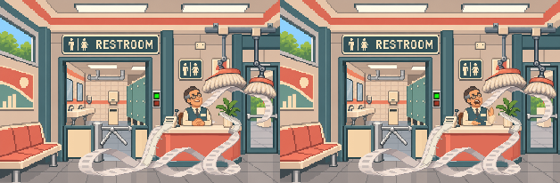

# Paper Emergency localized repair candidate v04

**Generated and unselected.** One preservation-first candidate from the currently approved `CH3-B06-paper-emergency-v03.png`, following Nate’s repair decisions. P1, the urgent mouth and coordinated hand/forearm pose change. P2 and the protected environment remain unchanged.

[HTML gallery](index.html) · [Portable HTML gallery](standalone-gallery.html) · [Exact masks and provenance](manifest.json) · [Actual QA results](qa/results.json)

[Full native comparison PNG](comparisons/approved-left-candidate-right-native.png) · [Full exact 4× comparison PNG](comparisons/approved-left-candidate-right-4x.png) · [Candidate native PNG](candidate/CH3-B06-paper-emergency-local-v04.png) · [Candidate exact 4× PNG](previews/paper-emergency-candidate-v04-4x.png)

## Changes

- **P1:** 18 changed pixels provide a short shadow/lit edge. The existing moving strip reads in front of the lower return; no route, source, branch or disconnected segment is created.
- **Face:** 37 changed pixels replace the smile with an urgent open mouth. Glasses, eyes, brows, nose, hair, jaw silhouette and head position remain unchanged. The approved alarmed portrait is a design reference, not a resized insert.
- **Hands and forearm:** 272 changed pixels remove the clasp, raise a restrained stop/leave palm and brace the other hand on the counter. No player, grab or new control is shown. The raised hand stays below the passing receipt and left of the plant.
- **P2:** KEEP, zero changes. Brushes, supports, architecture, signs, feed unit, microphone, plant, lighting and floor geometry stay unchanged. Fourteen formerly hand-occluded counter-edge pixels are restored inside the traced old-hand mask; existing visible countertop/fascia is preserved.

[Face close-up at exact 4×](comparisons/face-before-after-4x.png) · [Hands close-up at exact 4×](comparisons/hands-before-after-4x.png) · [P1 close-up at exact 4×](comparisons/P1-before-after-4x.png) · [P2 kept at exact 4×](comparisons/P2-kept-before-after-4x.png)

## Exact masks and preservation

327 pixels changed; 64,357 unchanged; **0 changes outside declared masks**. Declared masks contain 334 pixels and closely trace the intended strokes/old/new sprite shapes, not an NPC rectangle. Effective masks contain only actual changes. The original, all approved assets and all historical review files remain untouched.

[Every changed pixel CSV](sources/changed-pixels.csv) · [P1 declared mask](masks/P1-declared-mask.png) · [Face declared mask](masks/face-declared-mask.png) · [Hands declared mask](masks/hands-declared-mask.png) · [Effective change mask](masks/effective-change-mask.png) · [Exact transparent edit layer](sources/exact-native-edit-layer.png) · [Frozen repair plan](sources/repair-plan.json) · [Editable repair source](repair.py)

## Continuity and remaining judgments

No perspective correction or rescaling occurred. The receipt above the new gesture and the plant remain pixel-identical. Evaluate the mouth opening, small stop palm and local shading fit at native size and exact 4×. The braced hand conveys urgency but does not show a literal button press; no hardware is invented. P1 is a local depth cue, not an animated paper-flow simulation.

[Receipt clearance comparison](comparisons/receipt-clearance-before-after-4x.png) · [Desk contact comparison](comparisons/desk-contact-before-after-4x.png) · [Receipt continuity guide](assessment/receipt-continuity-guide-4x.png) · [Unchanged geometry guide](assessment/unchanged-geometry-guide-4x.png) · [Approved alarmed portrait](references/attendant-alarmed.png)

314×206 opaque RGB, exact 4× 1256×824. Original RGB count 20,305; candidate 20,133. No palette cap, generation, sharpening, posterization, filtering or downsampling. Original full-scene native-grid authorship remains unresolved; these are logged native-coordinate repairs only.

- Approved original SHA-256: `ac0f7c44d267dd54897507ae3b8b02959a5b76f4fcd9d0418b77b8fdb777ba7e`
- Candidate SHA-256: `93a48082124600b1afeb45e5ea54856bf253e858e55111295e9d9c26919bc978`

[Pixel/mask/preservation evidence](qa/pixel-and-preservation.json) · [QA actually run and not run](qa/results.json)

Stop for Nate’s final visual review. No canonical registration, integration, merge or public Pages deployment.
