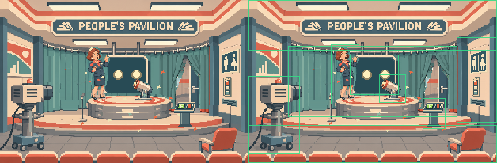

# Surprise Stage targeted quality assessment

**Recommendation: KEEP the currently approved C04 v04 unchanged.** No meaningful defect was demonstrated at native or exact 4×. This v05 label identifies the assessment, not a new artwork version. No candidate, no open repair mask, zero artwork pixels changed.

[Portable browser gallery](standalone-gallery.html) · [HTML assessment](index.html) · [Full findings](assessment/targeted-assessment.json) · [Source manifest](manifest.json) · [Actual QA](qa/results.json)

[Direct native comparison PNG](comparisons/approved-left-protected-guide-right-native.png) · [Direct exact 4× comparison PNG](comparisons/approved-left-protected-guide-right-4x.png) · [Approved original exact 4×](previews/approved-surprise-stage-4x.png)

## Preserve the earlier corrections

- Presenter remains entirely on the cannon’s left/firing side, at the existing scale and position. The approved 73-pixel translation is preserved.
- The barrel, cradle and mount are connected; visible aim is left/up. No new mechanical defect is demonstrated.
- Corrected right-wall pictogram, button group and PA grille retain their approved perspective.
- Left green BEGIN activation control and separate right red release under its raised cover remain distinct. Surprise’s brighter green lens is intentional.
- Two lamps represent TWO in the brief. Sparse confetti supports the startled beat without hiding important silhouettes.
- Camera, microphone, platform, furniture, floor and backstage access are coherent. No new perspective correction is justified.

[Firing-side and mount guide](assessment/firing-side-and-mount-guide-4x.png) · [Perspective construction overlay](assessment/perspective-construction-4x.png) · [Protected-detail guide](assessment/protected-detail-guide-4x.png) · [Closed 0-pixel mask](masks/proposed-repair-mask.png)

## Narrative and cross-scene continuity

The open mouth, raised hands, confetti and cannon support genuine_surprise. The raised platform fits the preceding identity-check beat, and the backstage doorway supports the exit. Certificate printing/crumpling and unlocking are later narrated actions, not mandatory simultaneous pixels.

Verification, Urgency and Locomotion comparisons in the gallery preserve native and exact 4× matching scales. Curtain color, moving-floor machinery, microphone presence and green-lens brightness have intentional state differences; do not flatten those differences into one generic stage. Main and close portrait-control order is consistent.

## Evidence

Current selected source: `7bf1f426f3a1d5dba14e7a1bd56ece86a4d23bdb`, `CH3-C04-surprise-v04.png`.

SHA-256: `8a85f438b734930985140851d38d2d691c8326e71d1aae7891e37b453a03412d`.

314×206 opaque RGB; exact 4× 1256×824. 15,641 unique RGB colors and source-derived softness do not by themselves justify editing. Original full-scene native-grid authorship remains unresolved. Earlier v04 wall geometry was an authored camera interpretation, not recovered calibration. All original bytes and prior approvals remain unchanged.

[Preservation checks](qa/preservation.json) · [QA run and not run](qa/results.json) · [Earlier correction record](sources/118_OUT_OF_ORDER_CH3_V04_PERSPECTIVE_REVIEW_20261120.md) · [Later owner approval](sources/119_OUT_OF_ORDER_CH3_CURRENT_APPROVAL_REGISTRATION_HANDOFF_20261120.md)

Stop for Nate’s visual review. No canonical registration, integration, Chapter 4 change, merge or public Pages deployment.
