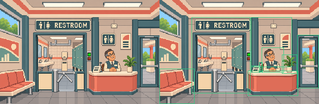

# Restroom Entrance A01 targeted assessment

**Recommendation: KEEP the approved A01 v09 unchanged.** No meaningful defect is demonstrated at native or exact 4×. Zero artwork pixels changed. No candidate; the proposed repair mask is closed (0 pixels). This v06 package is an assessment version, not a new artwork version.

[Portable browser gallery](standalone-gallery.html) · [HTML assessment](index.html) · [Full findings](assessment/targeted-assessment.json) · [Manifest](manifest.json) · [Actual QA](qa/results.json)

[Direct native comparison](comparisons/approved-left-protected-guide-right-native.png) · [Direct exact 4× comparison](comparisons/approved-left-protected-guide-right-4x.png) · [Original exact 4×](previews/approved-restroom-entrance-4x.png)

## Findings and protection

- Reassuring smile, glasses, hair, clasped hands, cream shirt, teal vest, tie and badge fit the entrance dialogue and approved idle portrait. No expression or silhouette repair is justified.
- Preserve the earlier v09 microphone correction exactly: head, background gap, curved stem and desktop base. The copied historical edit record documents its 59-pixel correction; this assessment changes none of those pixels.
- Keep the left cream feed unit, centered attendant, right plant and counter geometry. Do not restore the separate unwanted desktop device or create a printer/plant overlap.
- RESTROOM, both two-person pictograms, doorway, reader, gate, interior fixtures, daylight and bench remain readable and grounded.
- No demonstrated wall, floor, furniture or equipment perspective error. The desk occludes the seated lower body; no visible feet are needed. Construction guides are approximate traces, not camera calibration.

[Protected-detail guide](assessment/protected-detail-guide-4x.png) · [Perspective/contact guide](assessment/perspective-construction-4x.png) · [Guide coordinates](assessment/perspective-guides.json) · [Closed repair mask](masks/proposed-repair-mask.png) · [Empty changed-pixel list](sources/changed-pixels.json)

## Continuity

Record Printer keeps the establishing layout and adds receipt activity at the left unit. Paper Emergency's urgent pose belongs to that later event; do not transfer it into the reassuring entrance image. The gallery shows both Nate-selected v04 (separate Claude registration pending) and historical v03 (still canonical), clearly labeled.

The approved portrait background is an independent close camera with consistent materials, doorway/gate, left intercom, microphone and right plant. Its larger intercom footprint is not a missing device to restore into A01. The unmodified approved background and idle portrait are shown separately and in a diagnostic composite; neither layer is edited.

No manual finish is presently justified by a demonstrated native/4× readability defect. Large palette and source-derived softness are not reasons to repaint successful details.

## Source and checks

Approved source: `a87155bfadad42e0deae3bee2e749963d1459a4b`, `CH3-A01-restroom-v09.png`.

SHA-256: `117dd9d00b6c9d32b4b153f71aaf51c2546ade70b803d45a748728f8d1a1f8b4`.

314×206 opaque RGB; exact 4× 1256×824. Original full-scene native-grid authorship remains unresolved/unproven. The earlier localized microphone authorship does not establish inherited full-scene authorship. No filtering, palette limit or image generation.

[Preservation evidence](qa/preservation.json) · [Actual QA / exclusions](qa/results.json) · [Current approval evidence](sources/approved-ledger-excerpt.md) · [Historical microphone correction](sources/historical-v09-edit-record.json) · [Narrative excerpts](sources/narrative-excerpts.json)

Stop for Nate's visual review. No canonical registration, gameplay integration, merge, public Pages deployment or Chapter 4 change.
